# Portfolio — Dinamik Portfolyo Sitesi ve Yönetim Paneli


ASP.NET Core MVC ile geliştirdiğim, **tüm içeriği bir yönetim paneli üzerinden yönetilebilen**, veritabanı destekli dinamik bir kişisel portfolyo uygulaması. Ziyaretçi tarafındaki her bölüm (hero, hakkımda, eğitim, deneyim, yetenekler, projeler, sertifikalar, iletişim) veritabanından beslenir; içerik değişikliği için kod değiştirmek gerekmez.

> Bu proje **M&Y Yazılım Eğitim Akademi Danışmanlık** bünyesindeki ASP.NET Core MVC eğitimi kapsamında, *12. Dönem Akşam Grubu 1. Proje — Portfolyo Case* olarak geliştirilmiştir.

<p align="center">
  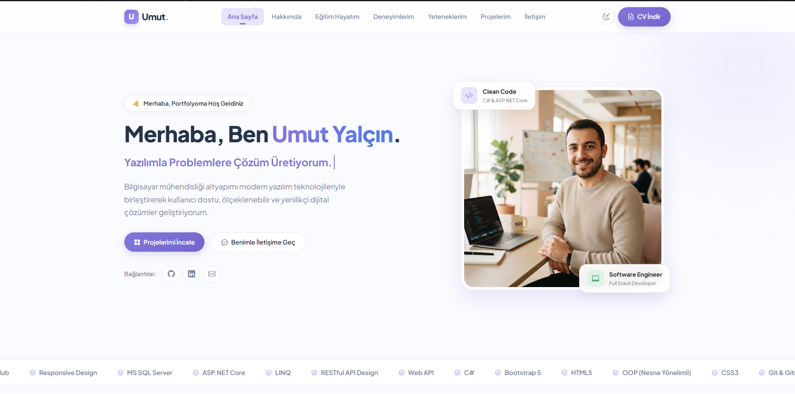
</p>

---

## İçindekiler

- [Ekran Görüntüleri](#ekran-görüntüleri)
- [Özellikler](#özellikler)
- [Kullanılan Teknolojiler](#kullanılan-teknolojiler)
- [Mimari ve Klasör Yapısı](#mimari-ve-klasör-yapısı)
- [Veri Modeli](#veri-modeli)
- [Kurulum](#kurulum)
- [Yönetim Paneli](#yönetim-paneli)
- [CV Nasıl Çalışır?](#cv-nasıl-çalışır)
- [Doğrulama ve Güvenlik](#doğrulama-ve-güvenlik)
- [Bilinen Sınırlamalar](#bilinen-sınırlamalar)
- [Lisans](#lisans)

---

## Ekran Görüntüleri

### Ziyaretçi arayüzü

| Karşılama (Hero) | Koyu tema |
|---|---|
|  | 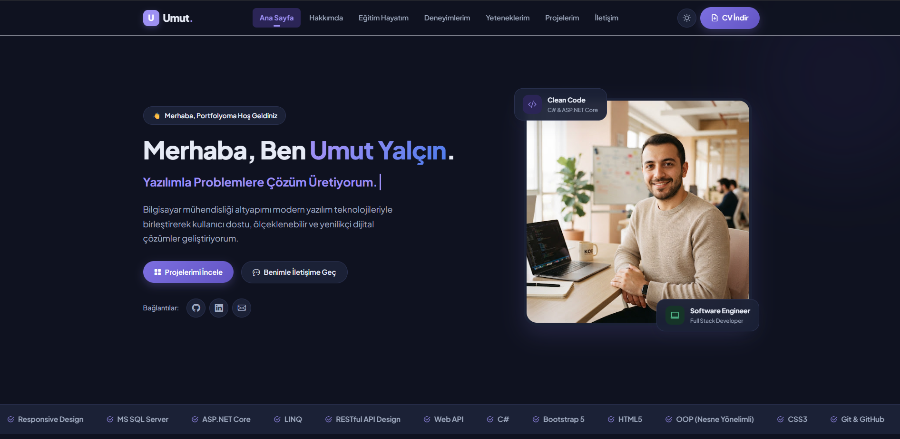 |

| Hakkımda ve eğitim / deneyim zaman çizelgesi | Yetenekler |
|---|---|
| 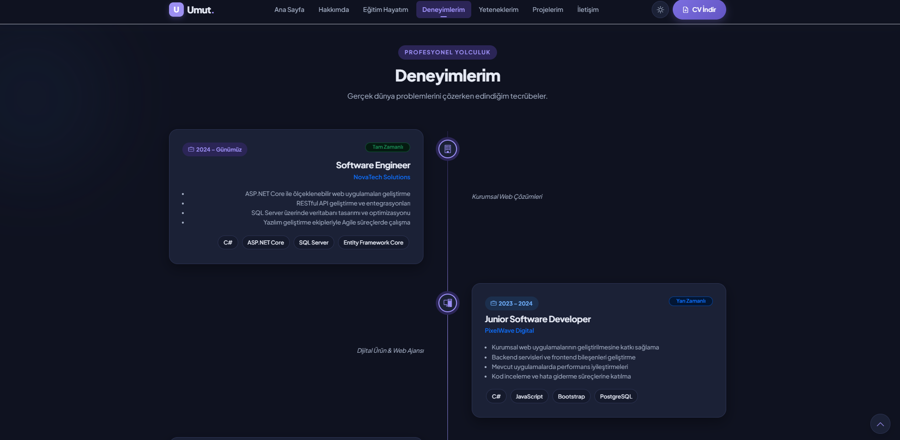 | 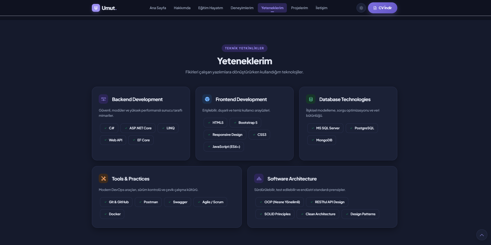 |

| Kategoriye göre filtrelenen projeler | İletişim formu |
|---|---|
| 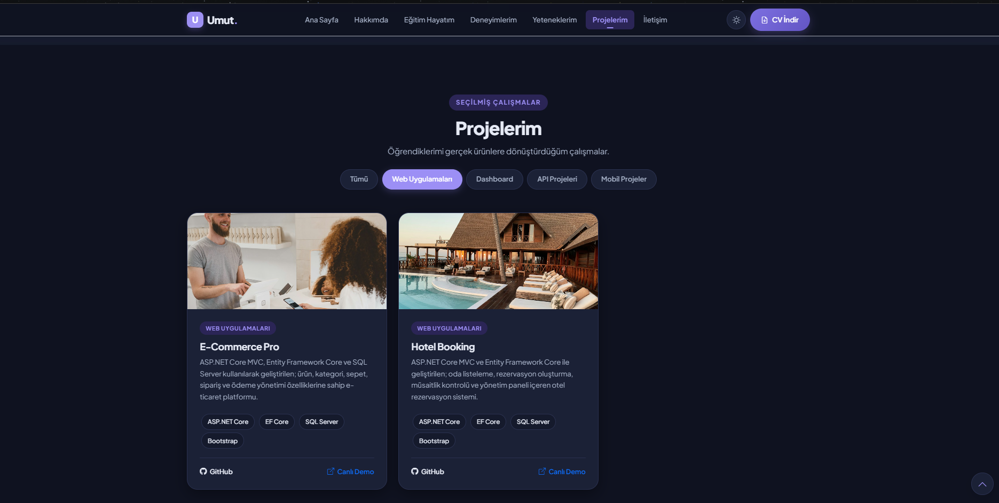 | 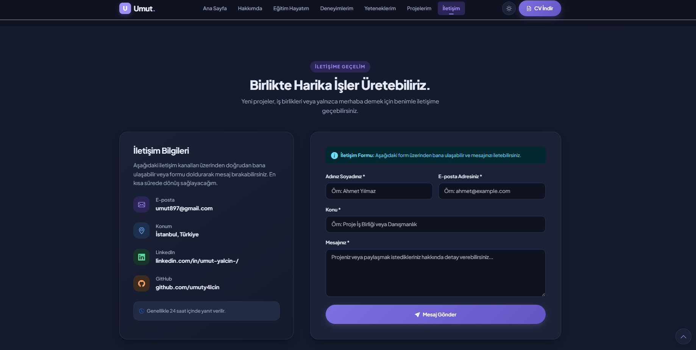 |

### Yönetim paneli

| Dashboard | Dashboard (koyu tema) |
|---|---|
| 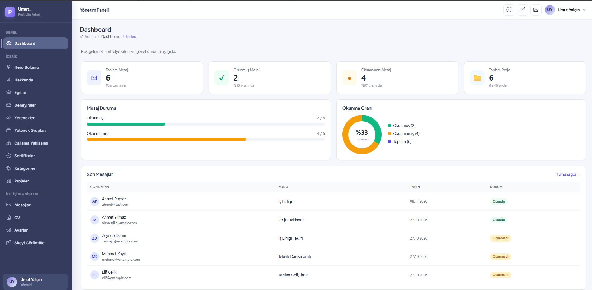 | 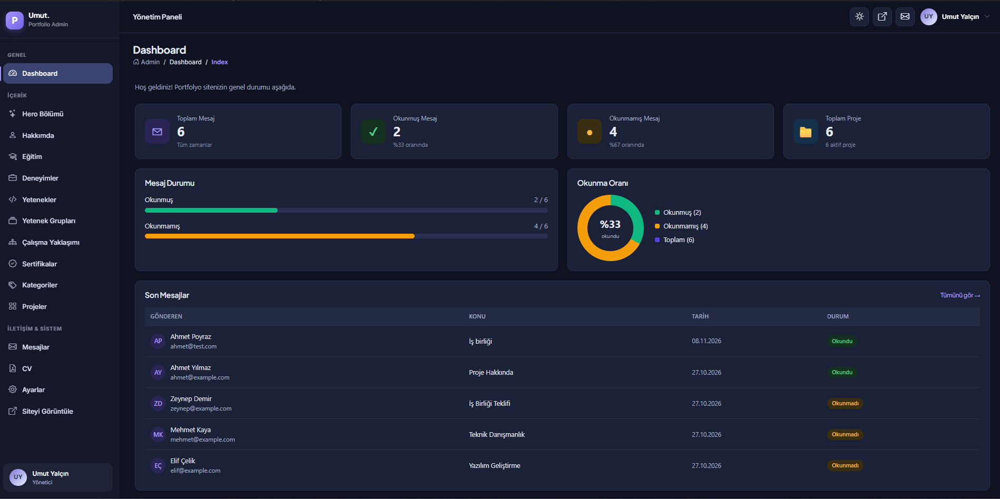 |

| Proje listesi | Proje formu (görsel yükleme) |
|---|---|
| 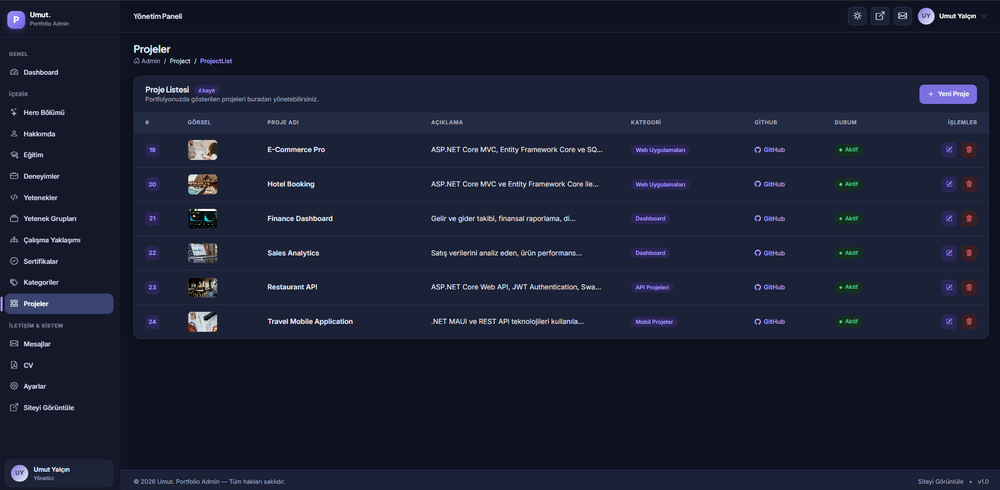 | 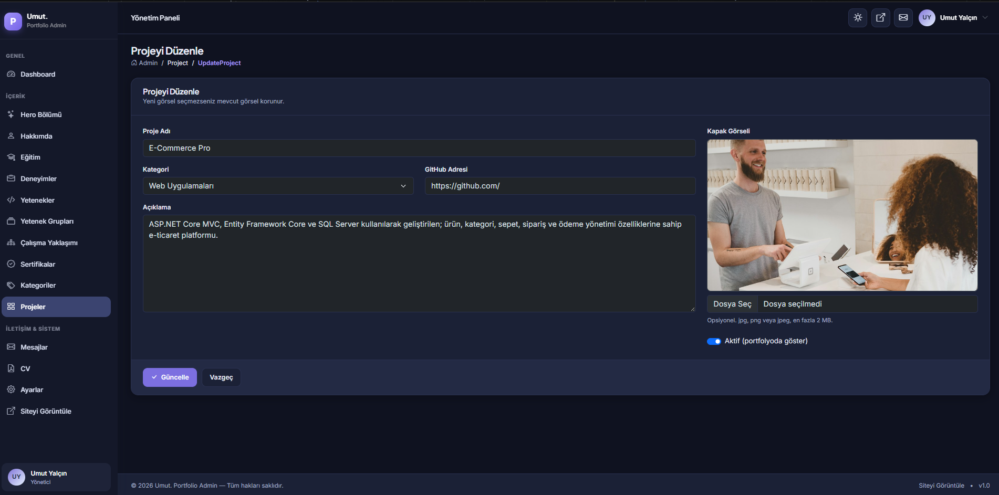 |

| Mesajlar (arama, filtre, modal) | Yetenekler |
|---|---|
| 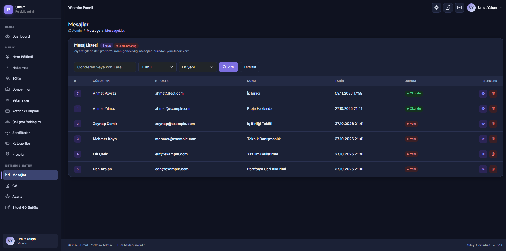 | 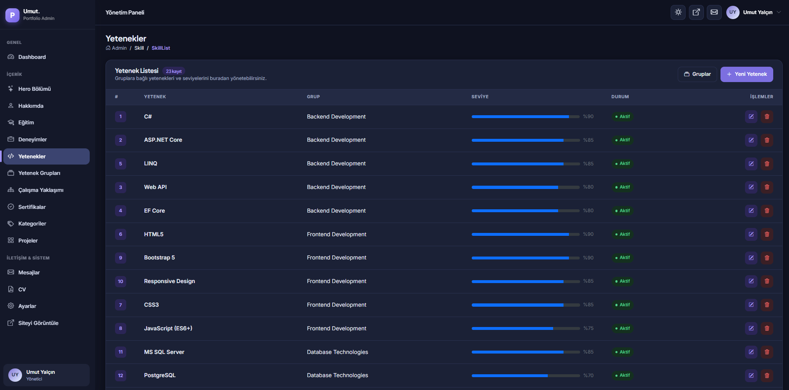 |

| CV yönetimi | Silme onayı (SweetAlert2) |
|---|---|
| 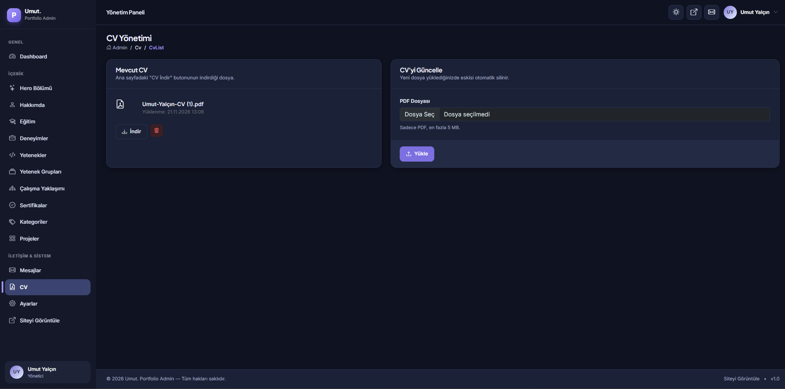 | 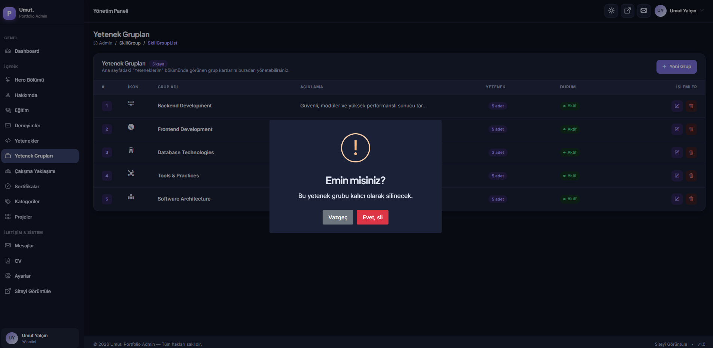 |

| Özel 404 sayfası |
|---|
| 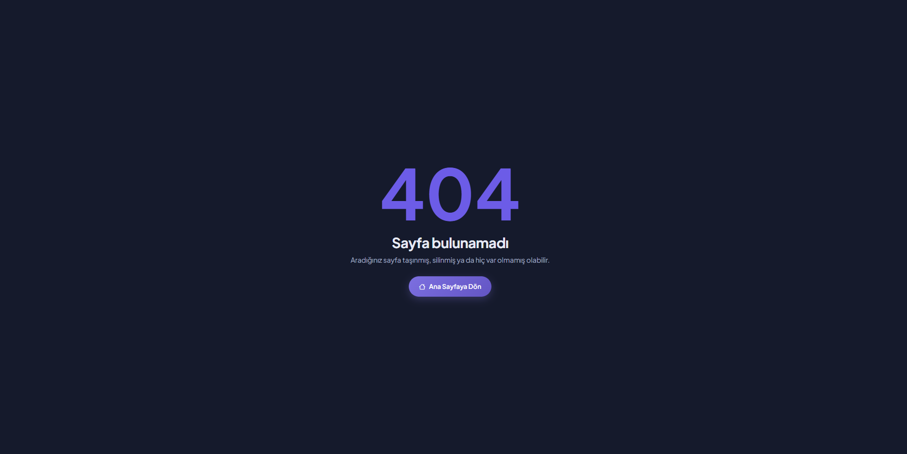 |

---

## Özellikler

### Ziyaretçi arayüzü
- **Hero:** Ad, rozet metni, açıklama, sosyal bağlantılar ve portre görseli veritabanından gelir; yazılıp silinen unvan animasyonu.
- **Hakkımda, Eğitim, Deneyim:** Eğitim ve deneyim, sol/sağ dönüşümlü zaman çizelgesi olarak listelenir. Pasif kayıtlar görünmez; deneyimler tarihe göre sıralanır, bitiş tarihi boşsa "Günümüz" yazar.
- **Yetenekler:** Gruplara ayrılmış kartlar, seviye bilgisi (tooltip) ve kayan teknoloji şeridi.
- **Projeler:** Kategori butonları veritabanındaki kategorilerden üretilir; JavaScript ile anında filtreleme yapılır.
- **Çalışma Yaklaşımı ve Sertifikalar:** Sıralanabilir adımlar ve isteğe bağlı doğrulama bağlantılı sertifikalar.
- **İletişim formu:** Mesajlar doğrulanarak veritabanına kaydedilir, TempData ile bilgi verilir.
- **CV indirme:** Tek tıkla PDF indirme.
- **Açık / koyu tema:** Tercih tarayıcıda saklanır, ilk ziyarette sistem temasına uyar.
- **Özel 404 ve hata sayfası.**

### Yönetim paneli
- **Dashboard:** Mesaj / proje / kategori sayıları, okundu-okunmadı oranı, son mesajlar, son projeler ve kategori bazlı proje dağılımı.
- **Hero, Hakkımda, Ayarlar (iletişim bilgileri):** Tek kayıtlı sayfalar; kayıt yoksa ilk kayıtta oluşturulur.
- **Eğitim, Deneyim, Yetenek Grubu, Yetenek, Çalışma Yaklaşımı, Sertifika, Kategori, Proje:** Tam CRUD, aktif / pasif durumu.
- **Proje yönetimi:** Kapak görseli yükleme (uzantı ve boyut kontrolü, eski görselin diskten silinmesi), kategori seçimi (`SelectList`).
- **Mesajlar:** Arama, okundu / okunmadı filtresi, sıralama, modalda mesaj görüntüleme (okundu olarak işaretler), e-posta ile yanıtlama bağlantısı.
- **CV yönetimi:** PDF yükleme, güncelleme ve silme.
- **Kullanıcı deneyimi:** SweetAlert2 ile silme onayı, TempData ile başarı / hata mesajları, ortak tasarım bileşenleri.

---

## Kullanılan Teknolojiler

| Katman | Teknoloji |
|---|---|
| Çatı | ASP.NET Core MVC, .NET 10 |
| Dil | C# (nullable reference types açık) |
| Veri erişimi | Entity Framework Core 10 (Code First, Migrations), LINQ |
| Veritabanı | Microsoft SQL Server (LocalDB) |
| Arayüz | Razor, Bootstrap 5.3, Bootstrap Icons, JavaScript (ES6), SweetAlert2 |
| PDF | QuestPDF (otomatik CV üretimi) |

---

## Mimari ve Klasör Yapısı

Ziyaretçi arayüzü **ViewComponent**'lere bölünmüştür; her bölüm kendi veri sorgusunu ve view'ını taşır. Yönetim paneli **Areas** yapısıyla ayrı tutulur.

```text
Portfolio/
├── Areas/Admin/
│   ├── Controllers/          # Tüm CRUD controller'ları (Project, Skill, Message, Cv, ...)
│   ├── Models/               # Dashboard için ViewModel
│   ├── ViewComponents/       # Admin layout parçaları (Head, Sidebar, Navbar, Footer, Script, Style)
│   └── Views/                # Modül başına liste / oluştur / düzenle sayfaları
├── Controllers/              # Ziyaretçi tarafı (ana sayfa, mesaj gönderme, CV indirme, hata sayfası)
├── ViewComponents/           # Ana sayfa bölümleri (Hero, About, Education, Skills, Project, ...)
├── Views/                    # Ana sayfa ve bölüm view'ları (Shared/Components/...)
├── Entities/                 # EF Core varlıkları (Data Annotations ile)
├── Context/                  # PortfolioContext (DbContext)
├── Services/                 # CvPdfBuilder (QuestPDF ile CV üretimi)
├── Migrations/               # EF Core migration'ları
└── wwwroot/                  # Statik dosyalar, yüklenen görseller ve CV
```

---

## Veri Modeli

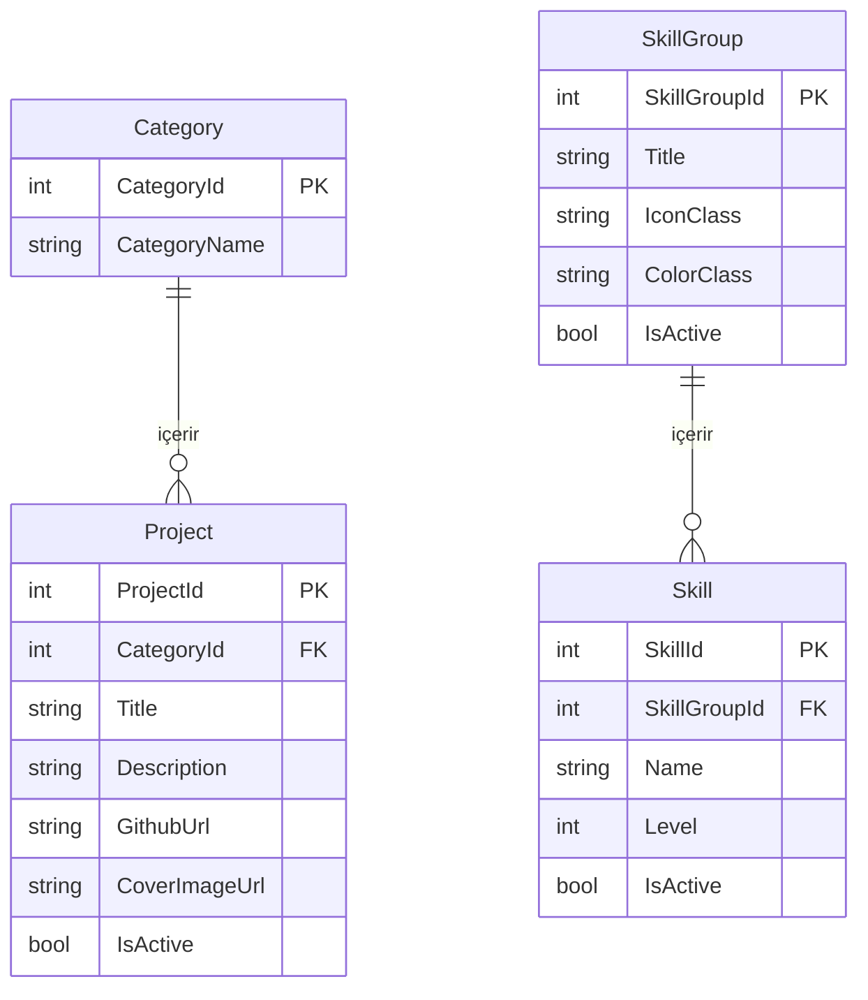

Bağımsız tablolar: `About`, `HeroSection`, `Contact` (tek kayıtlı), `Education`, `Experience`, `WorkflowStep`, `Certificate`, `Message` ve `CvFile`.

---

## Kurulum

### Gereksinimler
- [.NET 10 SDK](https://dotnet.microsoft.com/download)
- SQL Server LocalDB (Visual Studio ile birlikte gelir) veya herhangi bir SQL Server örneği
- EF Core CLI aracı (migration'ları uygulamak için): `dotnet tool install --global dotnet-ef`

### Adımlar

```bash
# 1. Depoyu klonlayın
git clone https://github.com/umuty4lcin/Portfolio.git
cd Portfolio/Portfolio

# 2. Veritabanını oluşturun (migration'ları uygular)
dotnet ef database update

# 3. Uygulamayı çalıştırın
dotnet run
```

Visual Studio kullanıyorsanız `Portfolio.slnx` dosyasını açıp **Package Manager Console**'da `Update-Database` komutunu çalıştırabilir, ardından `F5` ile başlatabilirsiniz.

Uygulama varsayılan olarak `https://localhost:7141` (veya `http://localhost:5132`) adresinde açılır.

### Bağlantı dizesi
Bağlantı dizesi [`Portfolio/appsettings.json`](Portfolio/appsettings.json) içindedir. LocalDB dışında bir SQL Server kullanacaksanız bu değeri değiştirin:

```json
"ConnectionStrings": {
  "DefaultConnection": "Server=(localdb)\\MSSQLLocalDB;Database=PortfolioDBNight;integrated security=true;trustservercertificate=true"
}
```

### İlk veri girişi
Veritabanı boş oluşturulur; ana sayfa boş tablolarla da hatasız açılır. İçeriği yönetim panelinden girin:

1. `/Admin/Hero/HeroList` ve `/Admin/About/AboutList` sayfalarında kişisel bilgileri kaydedin.
2. `/Admin/Setting/SettingList` sayfasında iletişim ve sosyal medya bilgilerini girin.
3. Kategori, proje, yetenek grubu ve yetenekleri ekleyin; eğitim, deneyim ve sertifikaları doldurun.

---

## Yönetim Paneli

Panel `/Admin` adresindedir (Dashboard).

| Sayfa | Adres |
|---|---|
| Dashboard | `/Admin` |
| Hero | `/Admin/Hero/HeroList` |
| Hakkımda | `/Admin/About/AboutList` |
| Eğitim | `/Admin/Education/EducationList` |
| Deneyimler | `/Admin/Experience/ExperienceList` |
| Yetenek Grupları | `/Admin/SkillGroup/SkillGroupList` |
| Yetenekler | `/Admin/Skill/SkillList` |
| Çalışma Yaklaşımı | `/Admin/WorkflowStep/WorkflowStepList` |
| Sertifikalar | `/Admin/Certificate/CertificateList` |
| Kategoriler | `/Admin/Category/CategoryList` |
| Projeler | `/Admin/Project/ProjectList` |
| Mesajlar | `/Admin/Message/MessageList` |
| CV | `/Admin/Cv/CvList` |
| Ayarlar | `/Admin/Setting/SettingList` |

---

## CV Nasıl Çalışır?

Ana sayfadaki **"CV İndir"** butonu `/Default/DownloadCv` adresine gider:

1. Yönetim panelinden **PDF yüklenmişse** o dosya indirilir. Yükleme yalnızca `.pdf` kabul eder, en fazla 5 MB'tır ve dosya içeriğinin gerçekten PDF olduğu (`%PDF` imzası) kontrol edilir. Yeni dosya yüklendiğinde eskisi diskten silinir.
2. **Yüklenmemişse** CV, sitedeki aktif bilgilerden (hakkımda, deneyim, eğitim, projeler, yetenekler, iletişim) QuestPDF ile otomatik üretilir.

---

## Doğrulama ve Güvenlik

- **Data Annotations** (`[Required]`, `[Url]`, `[Range]`, `[EmailAddress]`) ve sunucu tarafında `ModelState.IsValid` kontrolü; hatalar `asp-validation-for` ile gösterilir.
- **Silme işlemleri** yalnızca `POST` ile ve `[ValidateAntiForgeryToken]` korumasıyla yapılır. Onay penceresi SweetAlert2 ile gelir.
- **Dosya yükleme:** Uzantı beyaz listesi, boyut sınırı, rastgele (GUID) dosya adı ve yalnızca kendi klasörlerindeki dosyaların silinmesi.
- Kullanıcı girdileri Razor tarafından HTML olarak kodlanır, mesaj modalı içeriği `textContent` ile yazılır (XSS'e karşı).
- Bağlantı dizesi kod içinde değil, yapılandırma dosyasındadır.

---

## Bilinen Sınırlamalar

- Yönetim paneli **kimlik doğrulaması içermez** (case kapsamında istenmedi). Canlıya almadan önce ASP.NET Core Identity veya benzeri bir yetkilendirme eklenmelidir.
- Hero'daki yazılıp silinen unvan cümleleri ve yüzen küçük kartlar ana sayfa script'inde / view'ında sabittir.
- Projelerde kullanılan teknolojiler yetenek tablosuyla ilişkilendirilmemiştir (olası geliştirme: Proje–Yetenek çoka-çok ilişkisi).
- Doğrulama yalnızca sunucu tarafındadır; istemci tarafı anlık doğrulama (`jquery-validation`) eklenmemiştir.

---

## Lisans

Bu proje MIT lisansı ile dağıtılmaktadır. Ayrıntılar için [LICENSE.txt](LICENSE.txt) dosyasına bakın.
